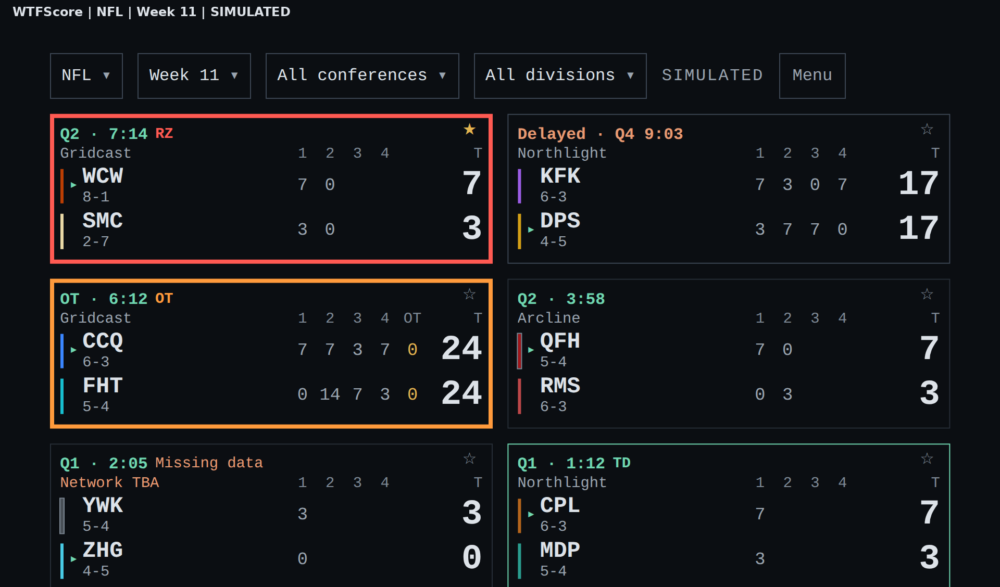
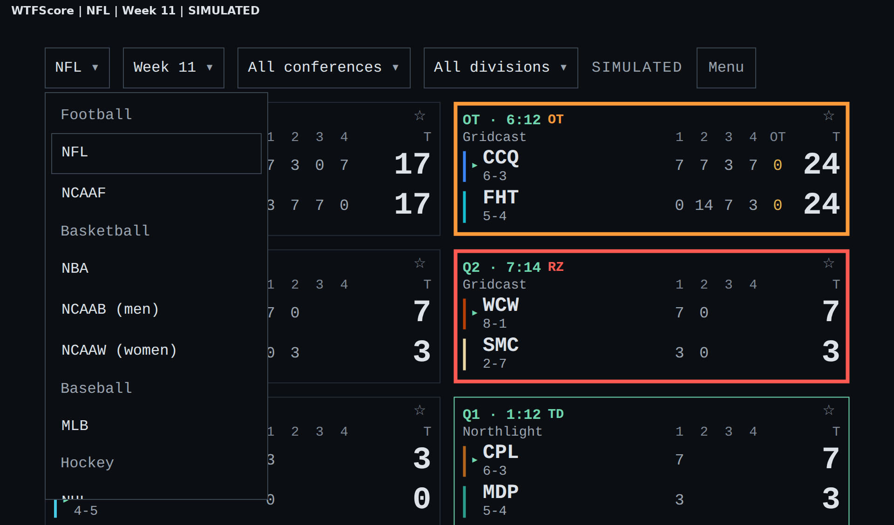
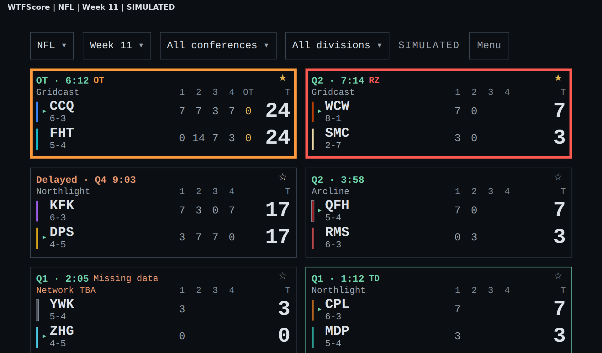
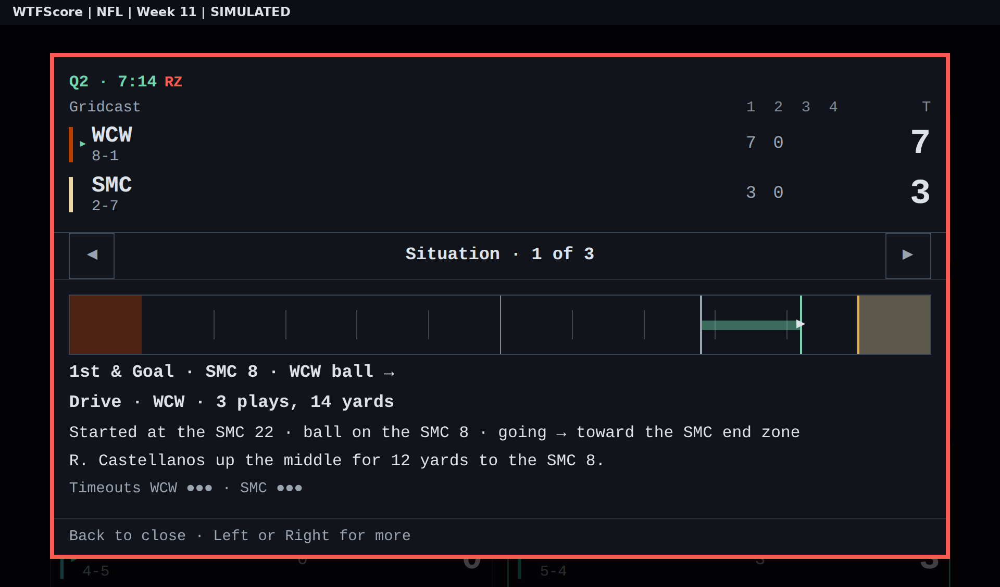
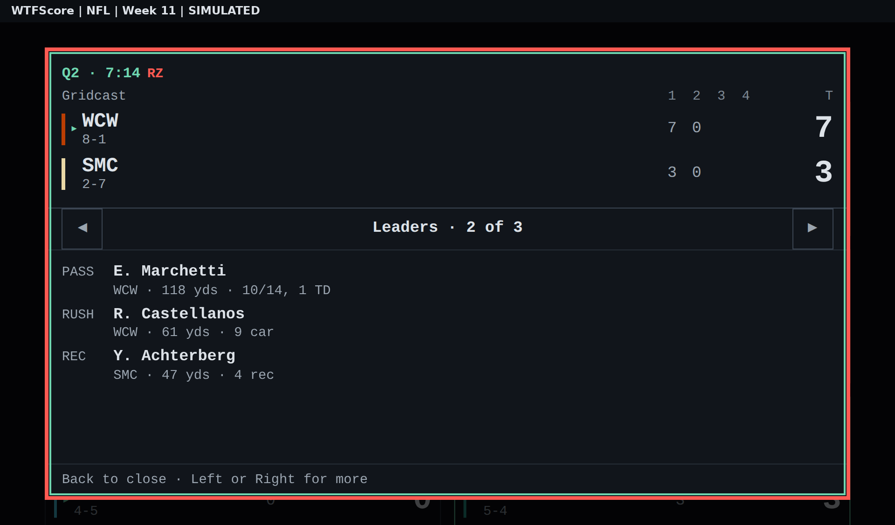
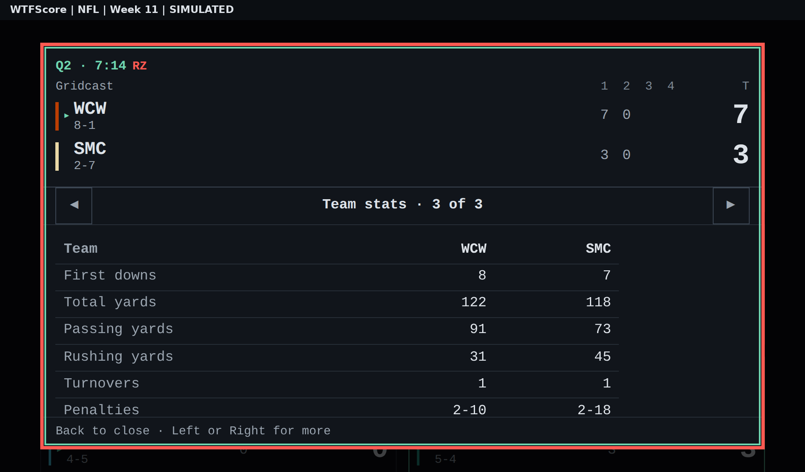

# WTFScore

A scores-first board for seven leagues, built for a TV and a phone.



**Prototype checkpoint. Every game, score, clock, player and statistic is simulated. There is no live feed.**

The gallery uses a fixed browser clock: Sunday, November 15, 2026, 3:50 PM Central.

## Pick the games

Choose NFL, NCAAF, NBA, NCAAB, NCAAW, MLB or NHL directly from the header. The adjacent control selects a football week, a calendar date or a postseason round. Conference, division and college filters follow the selected league.



## Football first

Favorite teams lift their games to the top. A card's star includes or excludes one game independently. The rest follow in-progress, upcoming and final order, with earlier kickoffs first.

Football priority frames use red for the red zone, orange for overtime or a one-score finish inside two minutes, and yellow for a game within ten points inside five minutes. Red zone takes precedence. Text labels accompany color.



## Open a game

On TV, the scorecard opens a foreground detail view. Left and Right step through Situation, Leaders and Team stats. Back returns to the same game. On a phone, details expand inside the board.





## Seven leagues, one board

Basketball, baseball and hockey use sport-specific linescores and fixture-backed situations. College basketball includes tournament and round controls. These shared-card renderings are prototypes; their sport-specific designs are still being worked out.

See the [16-state gallery](docs/SHOWCASE.md) and [feature coverage](docs/CAPTURE-COVERAGE.md).

## Built with browser standards

The app uses HTML, CSS and native JavaScript modules. It has no runtime package dependencies. The Node server serves the static frontend. The tests exercise the same modules and event handlers as the page. Phantom and Chromium are documentation tooling, separate from the app.

See [ARCHITECTURE.md](ARCHITECTURE.md) and [SECURITY-PRACTICES.md](SECURITY-PRACTICES.md).

## Run and test

Run on an approved server or CI host. Do not run app servers, builds or tests on the Mac mini.

```sh
node server.mjs
```

Open the loopback address printed by the server on that host. Public hosting is not part of this checkpoint.

```sh
node --max-old-space-size=256 --test --test-concurrency=1 --test-timeout=120000 test/*.test.mjs
```

Use a bounded job with a 768 MiB memory limit, no swap and a 300-second deadline. [Validation details](docs/VALIDATION.md) identify the tested source and capture run. No validation badge is claimed until its run passes.

## Current scope

- Games, teams, players, scores, clocks and stats are invented. League names describe the simulated boards. Conference and division memberships are fixture data.
- Favorites are held in memory per demo screen and reset on reload.
- There are no logos, accounts, saved profiles or live data providers.
- The screenshots come from headless Chromium at documented TV and phone sizes. They are layout proxies, not physical device tests.
- This checkpoint has not completed acceptance on a physical TV box or phone, in Safari or Brave, or with a screen reader.
- WTFScore is not affiliated with any sports league. League and conference names are used descriptively.

Each published image adds a 24 CSS pixel SIMULATED caption strip outside the app viewport. The app viewport pixels below it are unchanged. The manifest records both the raw and framed image hashes.
