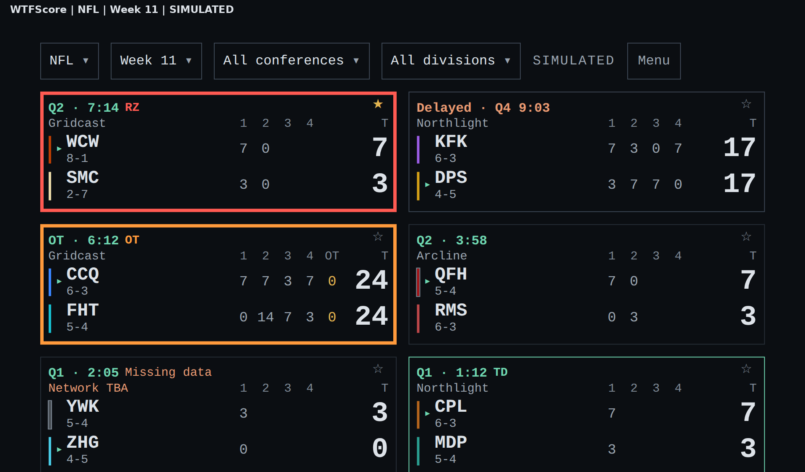
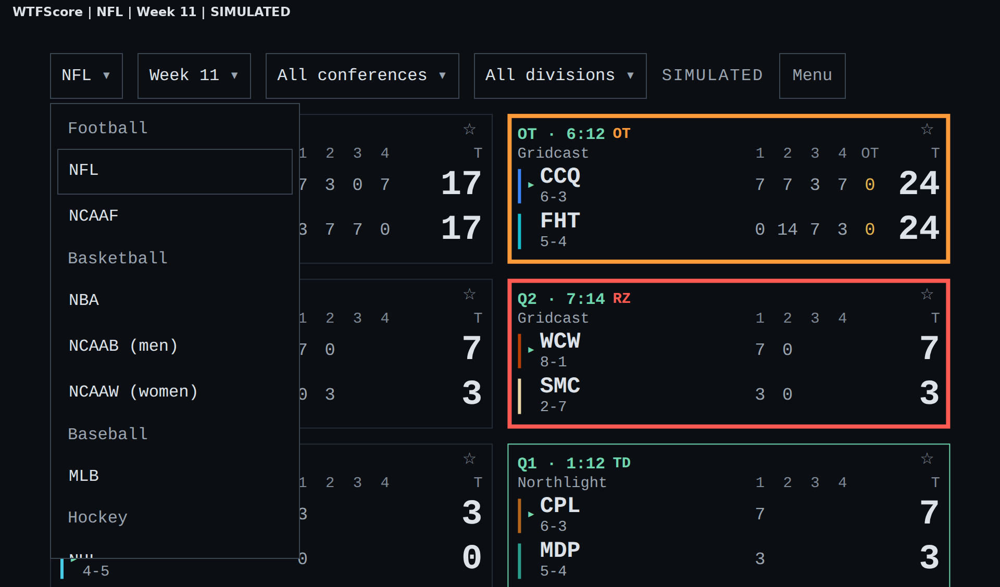
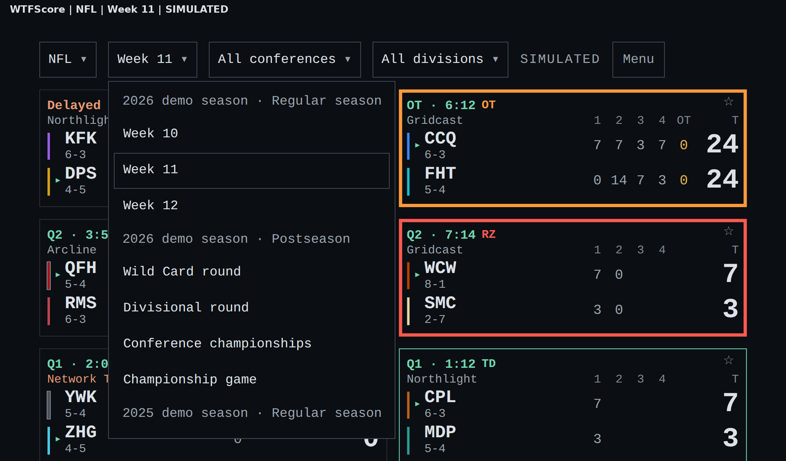
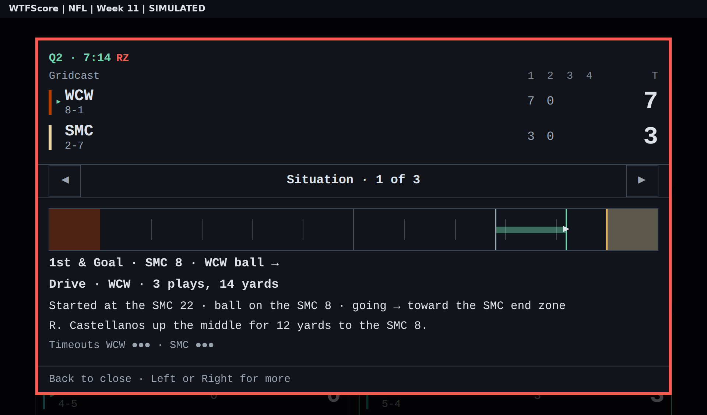
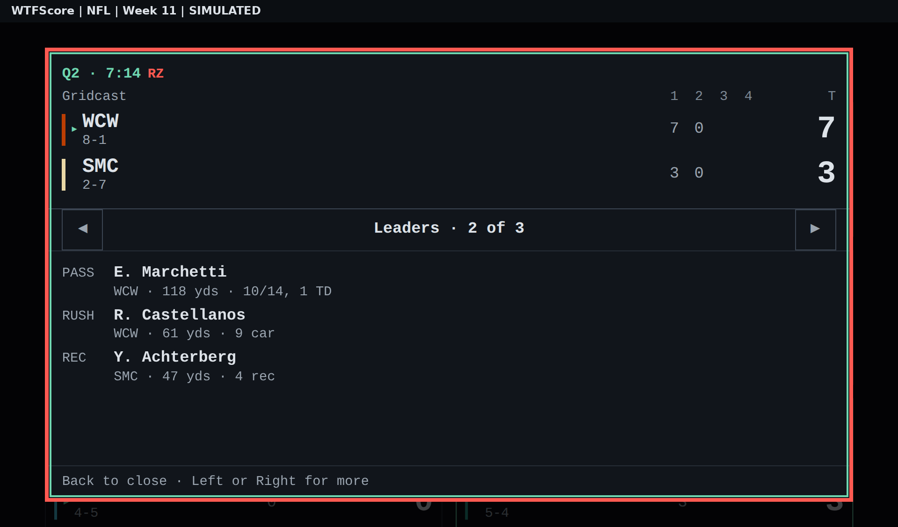
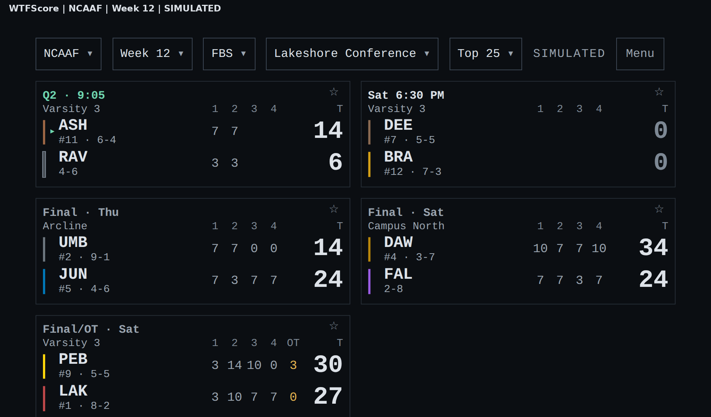
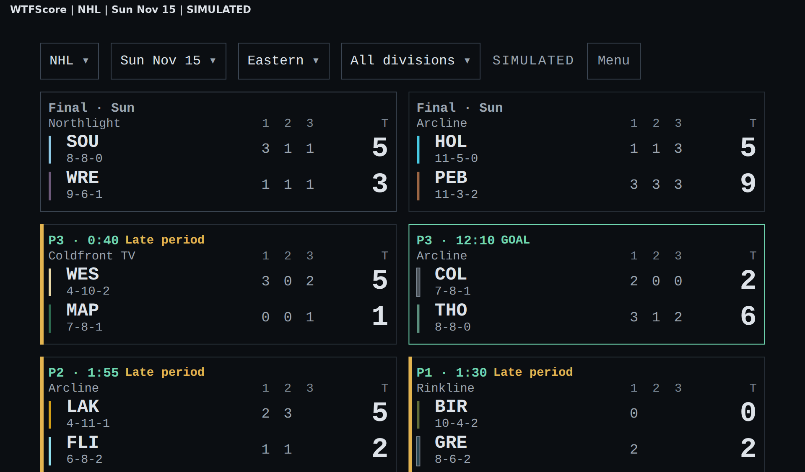
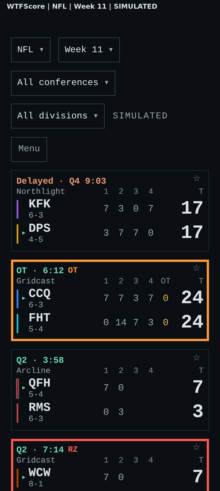
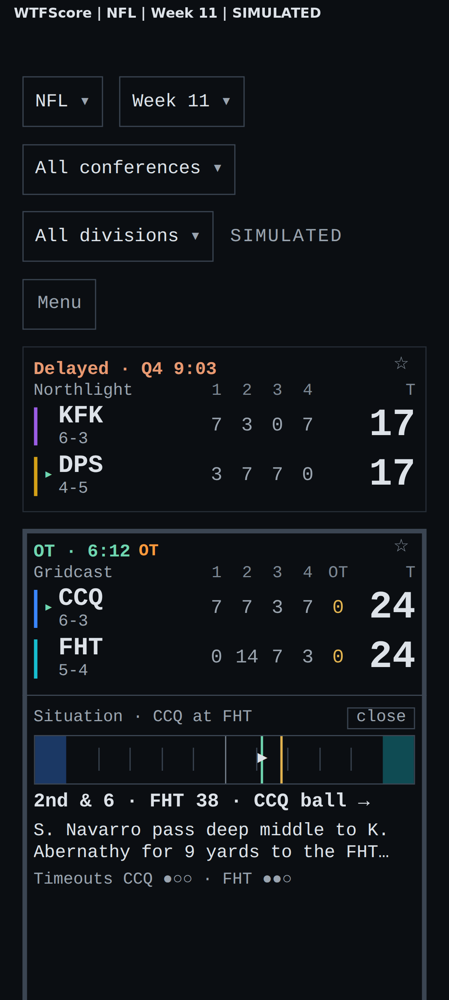
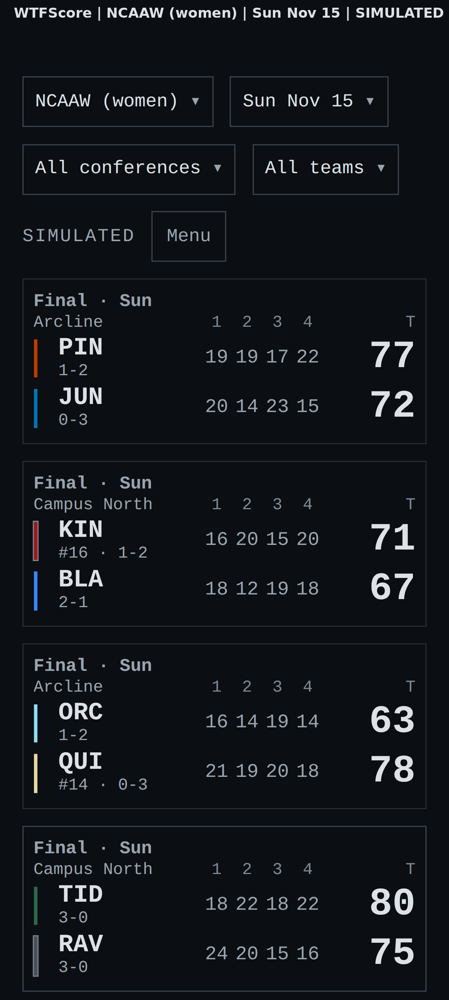

# Current-feature gallery

All games, teams, players and statistics are simulated. The browser clock is fixed at Sunday, November 15, 2026, 3:50 PM Central. TV captures use 960 × 540 CSS pixels at 2×. Phone captures use 390 × 844 at 3×. These are headless Chromium layout proxies.

These images were captured from pre-publication history that is kept privately; see [capture provenance](VALIDATION.md#capture-provenance). They show the v0.1.1 app. Current code fixes the gray hover border in shots 4 and 15 and the calendar footer in shot 10; see [focused UI regressions](VALIDATION.md#focused-ui-regressions).

## 1. NFL week board with a favorite team

## 2. League choices grouped by sport

## 3. NFL regular weeks and postseason rounds

## 4. NFL filtered to AFC North

Under the pointer, the card shows the gray hover border instead of its orange overtime border. The OT text remains orange.

## 5. A favorite team and an individual game favorite

## 6. TV foreground Situation

## 7. TV foreground Leaders

## 8. TV foreground Team stats

## 9. NCAAF FBS Top 25 in the Lakeshore Conference

## 10. NBA date picker with November 15 selected

The selected day, month title and round buttons are visible. The footer and later calendar rows require scrolling.

## 11. NCAAB NCAA tournament First Round

## 12. MLB American League East division

## 13. NHL Eastern conference

## 14. NFL board at phone width

## 15. NFL inline Situation at phone width

Under the pointer, the card shows the gray hover border instead of its orange overtime border. The OT text remains orange.

## 16. NCAAW board at phone width

Each published image adds a 24 CSS pixel SIMULATED caption strip outside the app viewport. The app viewport pixels below it are unchanged. The manifest records both the raw and framed image hashes.
