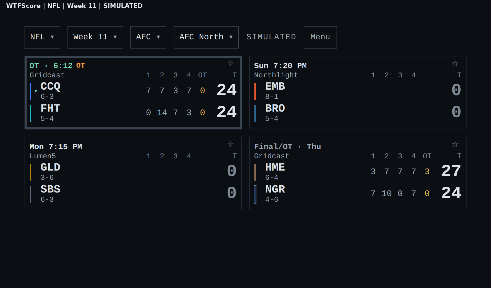
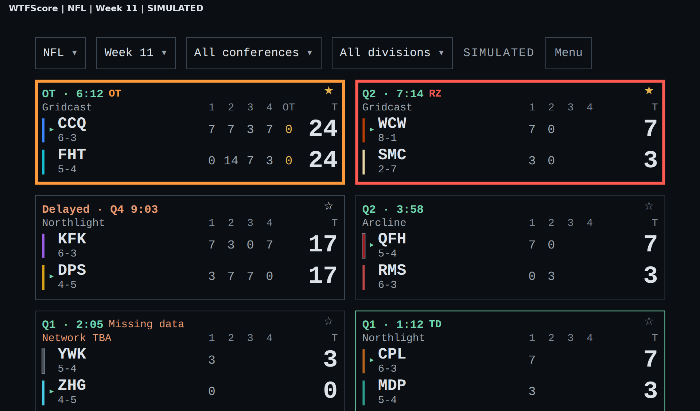
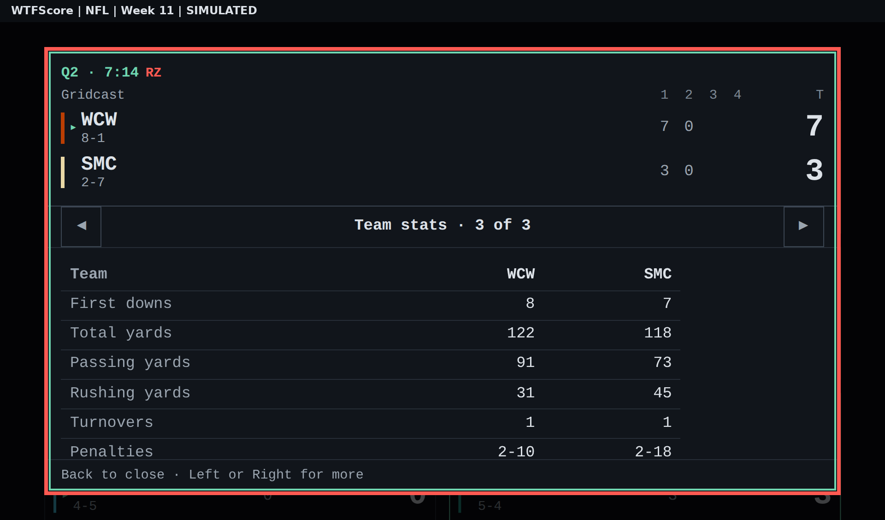
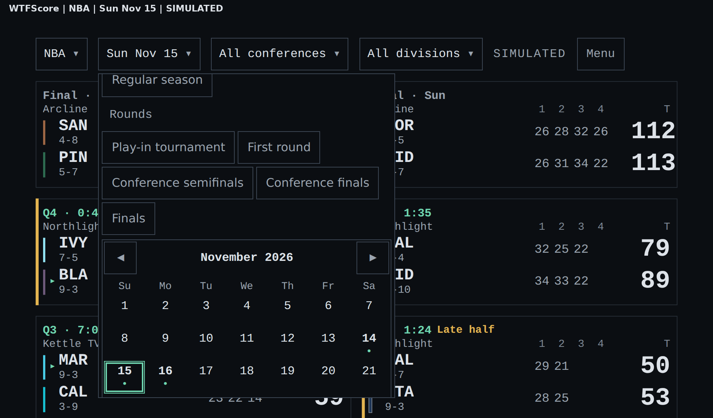
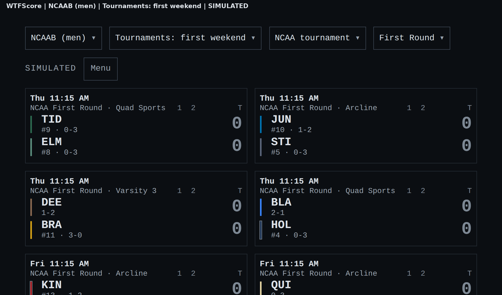
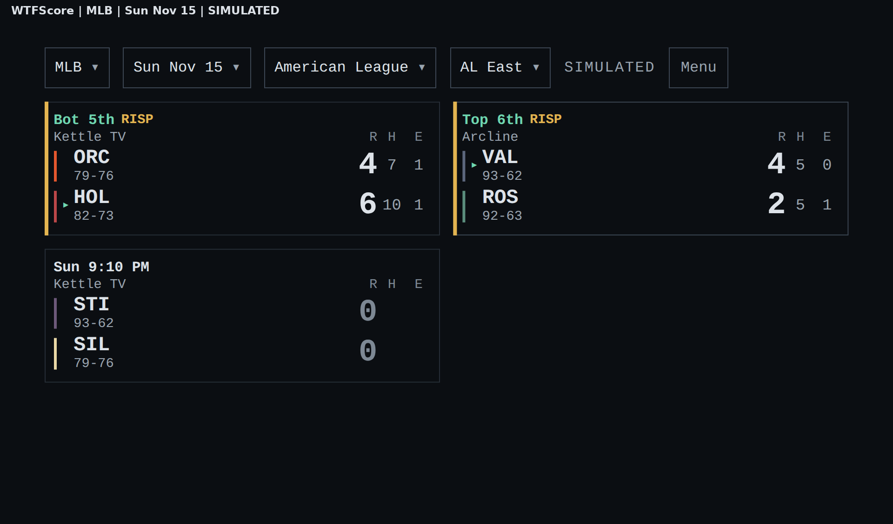

# Current-feature gallery

All games, teams, players and statistics are simulated. The browser clock is fixed at Sunday, November 15, 2026, 3:50 PM Central. TV captures use 960 × 540 CSS pixels at 2×. Phone captures use 390 × 844 at 3×. These are headless Chromium layout proxies.

## 1. NFL week board with a favorite team

This frame shows nFL week board with a favorite team.

## 2. League choices grouped by sport

This frame shows league choices grouped by sport.

## 3. NFL regular weeks and postseason rounds

This frame shows nFL regular weeks and postseason rounds.

## 4. NFL filtered to AFC North

This frame shows nFL filtered to AFC North.

## 5. A favorite team and an individual game favorite

This frame shows a favorite team and an individual game favorite.

## 6. TV foreground Situation

This frame shows tV foreground Situation.

## 7. TV foreground Leaders

This frame shows tV foreground Leaders.

## 8. TV foreground Team stats

This frame shows tV foreground Team stats.

## 9. NCAAF FBS Top 25 in the Lakeshore Conference

This frame shows nCAAF FBS Top 25 in the Lakeshore Conference.

## 10. NBA calendar with date and round controls

This frame shows nBA calendar with date and round controls.

## 11. NCAAB NCAA tournament First Round

This frame shows nCAAB NCAA tournament First Round.

## 12. MLB American League East division

This frame shows mLB American League East division.

## 13. NHL Eastern conference

This frame shows nHL Eastern conference.

## 14. NFL board at phone width

This frame shows nFL board at phone width.

## 15. NFL inline Situation at phone width

This frame shows nFL inline Situation at phone width.

## 16. NCAAW board at phone width

This frame shows nCAAW board at phone width.
